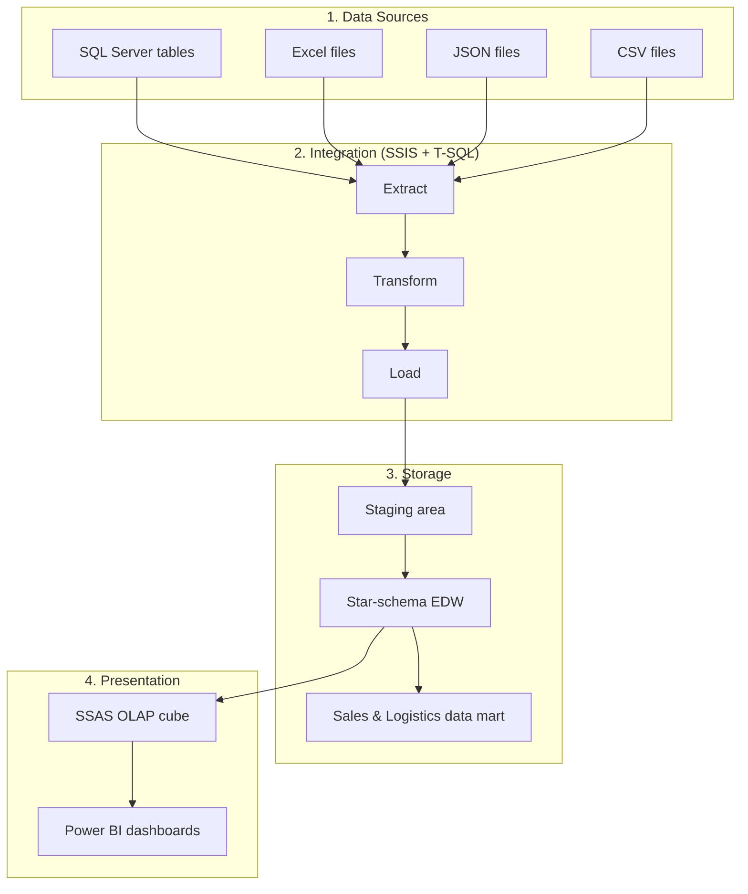

# Olist Data Warehouse & BI Solution

**IT3101 – Data Warehousing and Business Intelligence**
An end-to-end Data Warehouse and Business Intelligence solution for the Olist Brazilian e-commerce marketplace, built on the Microsoft BI stack: SQL Server, SSIS, SSAS (Multidimensional) and Power BI.

> Coursework project

---

## Contents
- [Business scenario](#business-scenario)
- [Dataset and sources](#dataset-and-sources)
- [Architecture](#architecture)
- [Dimensional model](#dimensional-model)
- [ETL](#etl)
- [Data mart](#data-mart)
- [OLAP cube and dashboards](#olap-cube-and-dashboards)
- [Key findings](#key-findings)
- [Repository structure](#repository-structure)
- [How to run](#how-to-run)
- [Design decisions](#design-decisions)
- [Acknowledgements](#acknowledgements)

---

## Business scenario

Olist is a marketplace connecting small Brazilian sellers with online customers. Its live transactional (OLTP) system is built to process orders, not to analyse history, so management can't quickly answer questions about sales, delivery performance and customer satisfaction.

This project builds a warehouse and BI layer that answers those questions fast, from one validated source of truth.

## Dataset and sources

**Dataset:** [Brazilian E-Commerce Public Dataset by Olist](https://www.kaggle.com/datasets/olistbr/brazilian-ecommerce) (Kaggle), orders from 2016 to 2018. About 99,400 orders and 1.55 million rows across 9 files.

> The dataset is **not included** in this repository. Download it from Kaggle (check the licence on the dataset page) and convert it as described below.

To demonstrate real multi-source integration, the nine CSV files were redistributed across four source types:

| Source type | Files | Represents |
|---|---|---|
| SQL Server (relational) | orders, order_items, customers | Order management system |
| Excel (.xlsx) | sellers, products | Partner / catalogue teams |
| JSON | order_reviews, geolocation | Customer-facing services |
| CSV (unchanged) | order_payments, product_category_name_translation | Payment gateway / reference data |

The sources are related through shared keys: `order_id` (orders, items, payments, reviews), `product_id` and `seller_id` (items to catalogue and sellers), and zip-code prefix (customers and sellers to geolocation).

## Architecture



## Dimensional model

A hybrid **star and snowflake** schema in database `assignment_dw`.

- **Fact table:** `Fact_Sales`, grain = one row per order line item
- **Measures:** price, freight value, payment value (prorated per item), item count, review score, delivery days, late-delivery flag
- **Dimensions:** `Dim_Customer`, `Dim_Seller`, `Dim_Product`, `Dim_Date`, and `Dim_Geography` (snowflaked, shared by Customer and Seller)
- **Keys:** integer surrogate primary keys on every dimension; the fact table holds them as foreign keys (all one-to-many)
- **Hierarchies:** Date (Year, Quarter, Month, Day), Geography (Country, Region, State, City), Product (Category, Product)
- **SCD:** Type 1 (overwrite). The data is a fixed historical extract; surrogate keys leave room to add Type 2 later.

## ETL

Implemented with **SSIS and T-SQL only** (no scripting languages).

- **Extract:** OLE DB Source (SQL tables), Excel Source, Flat File Source; JSON read with `OPENROWSET` + `OPENJSON` (SSIS has no native JSON source)
- **Transform:** cleansing, de-duplication (geolocation), type standardisation, derived attributes (delivery days, late-delivery flag, region), and per-item payment proration using a windowed `SUM() OVER (PARTITION BY order_id)`
- **Load order:** `Dim_Geography` → `Dim_Customer` / `Dim_Seller` → `Dim_Product` → `Dim_Date` → `Fact_Sales`
- **Validation:** row-count reconciliation, orphan-key check, payment reconciliation, range checks

### Bugs found and fixed during validation
| Issue | Cause | Fix |
|---|---|---|
| About 30K fact rows missing | Geography join matched on zip + city + state; spelling differences silently dropped rows | Match on zip prefix only, with an `Unknown` fallback and a quarantine table |
| Payment totals doubled for ~500 orders | Some orders have two reviews, so the review join fanned out rows | Keep only the most recent review per order |

Final result: **0 orphaned keys, 0 payment mismatches**, 110,194 fact rows (the gap from 112,650 order items is the non-delivered orders deliberately excluded).

## Data mart

The **Sales & Logistics Data Mart** serves sales operations, logistics coordinators and regional analysts.

- `vw_Mart_SalesLogistics`: flattened, row-level view with readable columns
- `Mart_SalesLogistics_Monthly`: pre-aggregated by month × seller region × product category

## OLAP cube and dashboards

An **SSAS Multidimensional** cube (`OlistSalesCube`) sits on the warehouse; **Power BI** connects to it live.

- Rate measures are **ratios of sums** (e.g. `Late Delivery Rate = Late Delivery Count / Order Item Count`), so they stay correct at every level of every hierarchy
- Two formal KPI objects: *Late Delivery Performance* and *Customer Satisfaction*
- MDX demonstrates slice, dice, drill-down, roll-up and pivot

**Dashboard pages**
1. **Executive Summary:** KPI cards, late-delivery KPI, satisfaction gauge
2. **Trend Analysis:** sales and review-score trends, region and category comparisons
3. **Interactive Analysis:** slicers, Region → State → City roll-up, Year → Quarter → Month drill-down

<!-- Add screenshots, e.g.:  -->

## Key findings

1. **Sustained growth:** partial-year 2018 sales already exceeded all of 2017
2. **Southeast dominance:** about 78% of revenue comes from one region
3. **Uneven delivery:** late-delivery rate ranges from 5.6% (Central-West) to 11.8% (North)
4. **Stable satisfaction:** review score stays around 4.1 despite rapid volume growth
5. **Demand varies by region:** the Northeast is led by computers; nationally, health and beauty leads

**Recommendations:** diversify the seller base (South, Northeast); prioritise delivery improvements by absolute volume; regionalise category and marketing plans; keep current satisfaction processes; run a monthly regional performance review.

## Repository structure

```
/sql
  dw_schema.sql                 Creates assignment_dw, dimensions and fact table
  etl_staging_and_extract.sql   Staging tables + JSON extraction
  etl_load_FINAL.sql            Transform, truncate-and-reload dimensions and fact, validation
  task6_data_mart.sql           Delivery-column migration, mart view and summary table
/ssis                           SSIS project (Excel, Flat File and OLE DB data flows)
/ssas                           OlistOLAP project (SSAS Multidimensional)
/powerbi                        Dashboard (.pbix)
/docs                           Report, slides, screenshots
/data                           (git-ignored) place the converted source files here
```

## How to run

**Requirements:** SQL Server, SQL Server Integration Services, SQL Server Analysis Services (Multidimensional), Visual Studio with SQL Server Data Tools (SSDT), Power BI Desktop.

1. **Get the data.** Download the Olist dataset from Kaggle and convert the files per the table in [Dataset and sources](#dataset-and-sources) (load orders/order_items/customers into SQL Server; save sellers/products as `.xlsx`; save reviews/geolocation as `.json`; keep payments and the category lookup as `.csv`).
2. **Create the warehouse.** Run `sql/dw_schema.sql`.
3. **Create staging and load JSON.** Edit the two file paths in `sql/etl_staging_and_extract.sql`, then run it.
4. **Load the remaining staging tables.** Run the SSIS package(s) in `/ssis` (update connection managers for your server and file paths).
5. **Transform and load the warehouse.** Run `sql/etl_load_FINAL.sql`. It is safe to re-run: it truncates and rebuilds the dimensions and fact table, but does not touch staging. Check that all validation queries at the end return the expected results.
6. **Build the data mart.** Run `sql/task6_data_mart.sql`.
7. **Deploy the cube.** Open the project in `/ssas`, point the data source at `assignment_dw`, then **Deploy** and **Process Full**.
8. **Open the dashboard.** In Power BI Desktop, connect live to the deployed `OlistSalesCube` and open the `.pbix`.

## Design decisions

- **ETL rather than ELT:** sources are heterogeneous and need cleaning and conforming before loading, and the brief specified SSIS. At about 1.5M rows, ELT's scalability benefits aren't needed. Heavy transforms still run as T-SQL inside SQL Server.
- **Hybrid schema:** only `Dim_Geography` is snowflaked (shared by two dimensions); everything else stays denormalised for simpler, faster queries. The cube flattens that branch back into a clean star.
- **Ratio-of-sums measures:** averages and rates are built from additive sums, avoiding the "average of averages" error that affected the first Power BI-only version.
- **Quarantine, not silent drops:** unmatched records are logged and routed to an `Unknown` member rather than discarded.

## Acknowledgements

- Dataset: Olist, via Kaggle. Please follow the licence on the dataset page.
- AI tools were used for brainstorming, drafting documentation and debugging support, in line with the module's AI-use policy. All implementation was reviewed, run and validated by the team. `<edit to match your report's declaration>`
